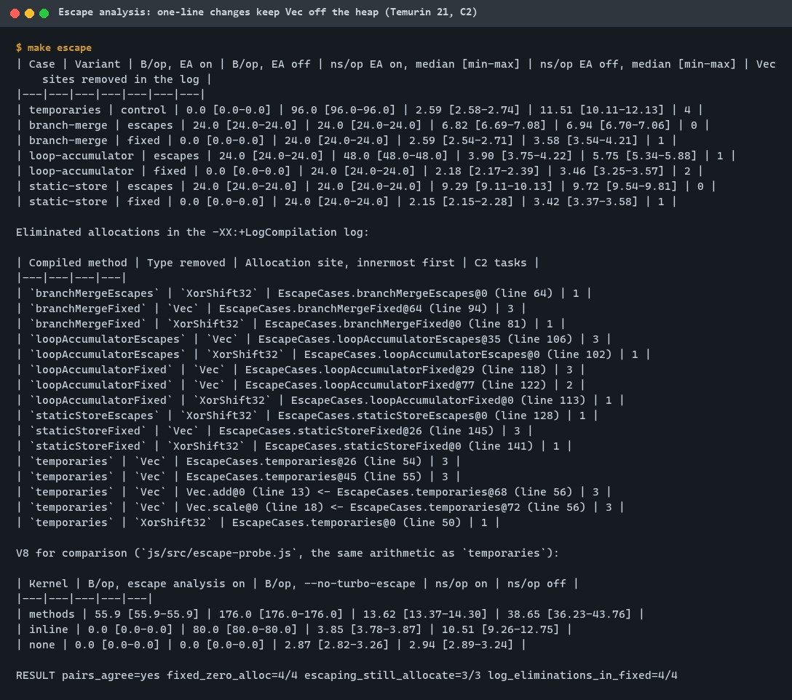
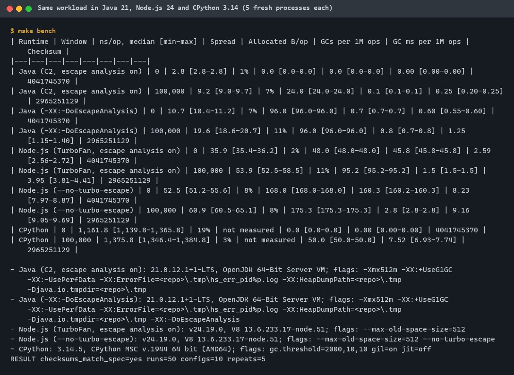
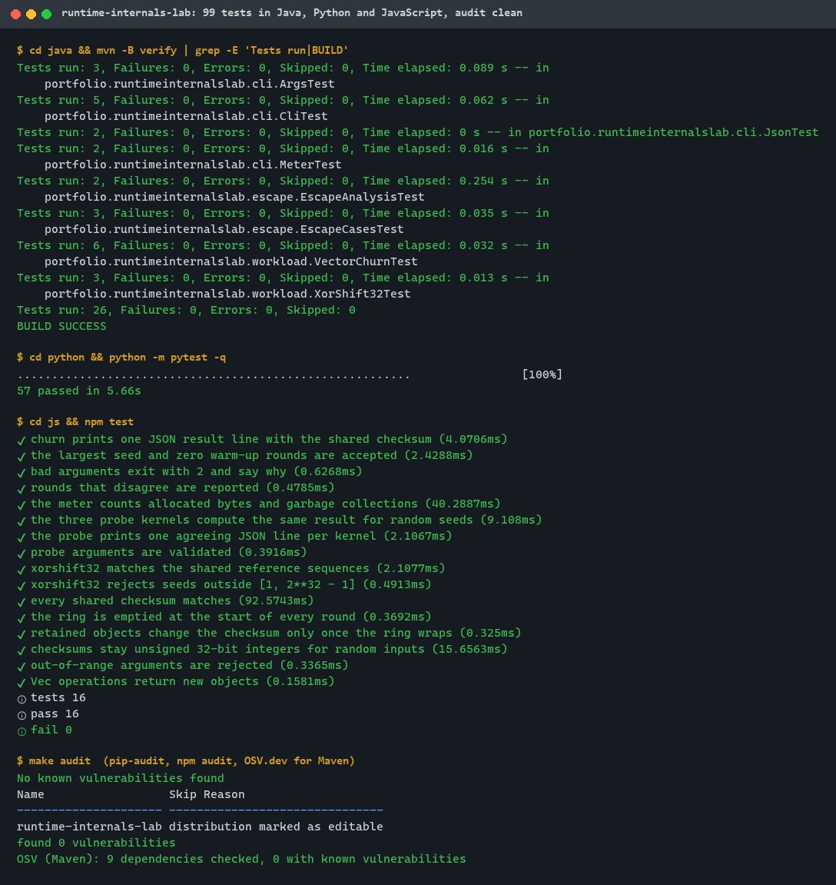
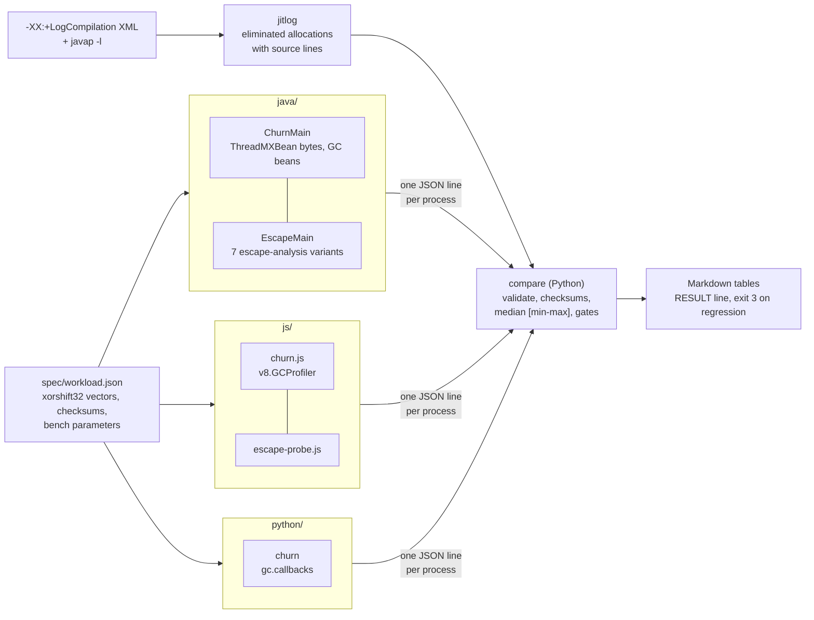
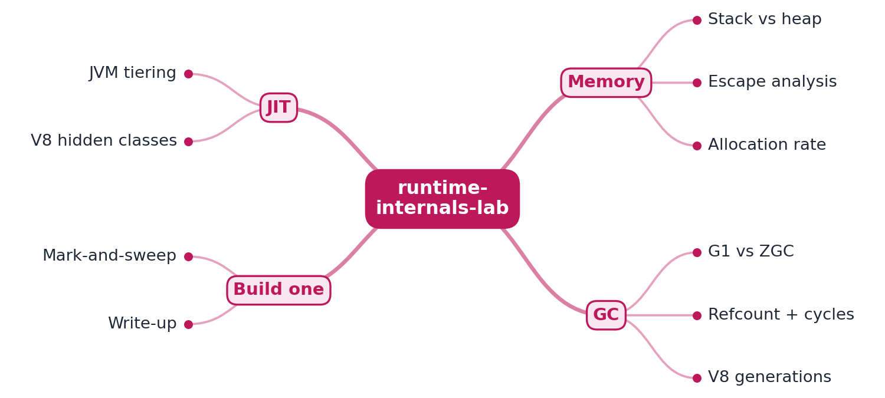
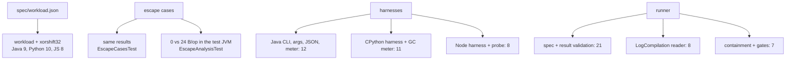

# runtime-internals-lab

[](https://github.com/EquinoxWN/runtime-internals-lab/actions/workflows/ci.yml)


> Answers 'why did latency spike when nothing changed?': how the JVM, CPython and V8 really manage memory, garbage collection and compilation.

Part of my **CS Foundations** list · Java · Python · JS

## Proof it works

One-line changes decide whether an object reaches the heap. With C2's escape analysis each fixed
variant allocates 0 bytes per operation, each escaping one still allocates a 24-byte object, and
the JIT's own compilation log lists exactly which allocations were removed, down to the source line:



The same allocation-heavy workload in Java 21, Node.js 24 and CPython 3.14, 5 fresh processes per
row; every run returns the checksum from the shared spec:



99 tests across the three runtimes and a clean dependency audit:



## Architecture

**What M1 runs today:**



**Full roadmap (M1 to M3):**



## How it works

_Steps 1 and 2 are built and tested (M1); the rest is on the [roadmap](#roadmap)._

1. The same allocation-heavy workload runs in Java, Python and JavaScript.
2. JIT escape-analysis logs show which objects avoid the heap, and how a small change keeps them off it.
3. JVM runs compare G1 and ZGC pause times using Java Flight Recorder.
4. CPython experiments show reference counting, the cycle collector and memory growth with tracemalloc.
5. V8 experiments show how hidden classes and inline caches speed up or slow down object access.
6. A tiny mark-and-sweep collector in Java makes the theory concrete.

## Who it helps

- **Who:** backend engineers who debug latency or GC overhead in Java, Node.js or Python services, and anyone preparing for "why is p99 spiky?" interview questions.
- **The problem:** a refactor that changes nothing functionally (an `if` that picks between two `new` expressions, an immutable accumulator, a reference kept "for debugging") can stop the JIT from removing an allocation, and the GC and tail latency change with it. Without measurements this stays folklore.
- **How to use it:** run `make escape` to see, for each pattern, the bytes per operation with escape analysis on and off and the allocations C2's own log says it removed; use `python -m runtime_internals_lab.jitlog` on a `-XX:+LogCompilation` log from your own service to list its eliminated allocations; run `make bench` to compare how the three runtimes handle short-lived and retained objects.

## Tech stack

| Area | In M1 | Planned |
|---|---|---|
| Java | Temurin 21, C2 escape analysis on/off, `ThreadMXBean` allocation counter, `-XX:+LogCompilation`; Maven, JUnit 6, Spotless | G1 vs ZGC with Java Flight Recorder (M2); a mark-and-sweep collector (M3) |
| JavaScript | Node.js 24 (V8 13.6), TurboFan escape analysis on/off, `v8.GCProfiler`; `tsc --checkJs --strict` | hidden classes, inline caches, heap snapshots (M3) |
| Python | CPython 3.14 workload with `gc.callbacks`; the runner, result validation and the LogCompilation reader; ruff, mypy `--strict`, pytest | reference counting, cycle collector and `tracemalloc` experiments (M2) |
| Proof | medians with min-max over 5 fresh processes, CI gates with `::notice` results | pause-time and allocation charts per runtime (M3) |

One implementation per language, each in its own folder: [`java/`](java) (Maven), [`js/`](js)
(Node.js, no runtime dependencies) and [`python/`](python) (also the experiment runner, see its
[README](python/README.md)). The workload is defined once in [`spec/workload.md`](spec/workload.md);
every suite reads [`spec/workload.json`](spec/workload.json).

## Run it

**Prerequisites:** JDK 21+ with Maven 3.9+, Python 3.11+ and Node.js 24+. Everything installs inside the repo.

```bash
python -m venv .venv && source .venv/bin/activate   # Windows: .venv\Scripts\activate
make setup    # Python dev tools, npm packages
make lint     # Spotless + javac -Xlint:all -Werror, ruff + mypy --strict, tsc --checkJs --strict
make test     # 99 tests across the three runtimes
make escape   # escape analysis on/off + LogCompilation evidence (about 30 s)
make bench    # the shared workload in Java, Node.js and CPython (about 2 minutes)
make audit    # pip-audit, npm audit, OSV.dev for Maven
```

One runtime at a time: `cd java && mvn verify`, `cd python && python -m pytest`, `cd js && npm test`.
Single runs: `java -Xmx512m -cp java/target/classes portfolio.runtimeinternalslab.cli.ChurnMain --window 100000`,
`node js/src/churn.js --window 100000`, `python -m runtime_internals_lab.churn --window 100000`.
Read any HotSpot compilation log: `python -m runtime_internals_lab.jitlog hotspot.log --only com.example.`.

Every JVM the project starts is capped at `-Xmx512m` and writes crash files, heap dumps, compile
logs and temp files only under the git-ignored `.tmp/`.

### The escape-analysis cases (`java/.../escape/EscapeCases.java`)

| Case | Escaping variant | The small change | Bytes/op, before to after |
|---|---|---|---|
| temporaries (control) | four temporaries through `add()`/`scale()` | - | 0 (96 with escape analysis off) |
| branch-merge | `v = cond ? new Vec(a, b) : new Vec(b, a)` | choose the ints, allocate once after the `if` | 24 to 0 |
| loop-accumulator | `sum = sum.add(step)` around the loop | add into two `int` locals, build one `Vec` at the end | 24 to 0 |
| static-store | `lastSeen = v` kept "for debugging" | keep `v.x()` and `v.y()` instead | 24 to 0 |

## Tests and results

Full numbers, commands and analysis: [docs/results/m1.md](docs/results/m1.md).

| Check | Result |
|---|---|
| Tests (`make test`) | **99 passed** (Java 26, Python 57, JavaScript 16), 0 failed; full check run twice |
| Lint (`make lint`) | clean: Spotless, javac `-Xlint:all -Werror`, ruff, ruff format, mypy `--strict`, tsc `--checkJs --strict` |
| Escape gate (`make escape`) | `pairs_agree=yes fixed_zero_alloc=4/4 escaping_still_allocate=3/3 log_eliminations_in_fixed=4/4` |
| Cross-runtime gate (`make bench`) | `checksums_match_spec=yes runs=50 configs=10 repeats=5` |
| Mutation check | 8 deliberate bugs: 6 caught at once, 1 caught after a test was added, 1 equivalent mutant |
| Audit (`make audit`) | pip-audit and npm audit: no known vulnerabilities; OSV.dev: 9 Maven dependencies, 0 vulnerable |

**Headline results** (Temurin 21.0.12.1, Node.js 24.19.0, CPython 3.14.5; medians of 5 processes):

| Result | Value |
|---|---|
| Java, 4 temporaries per op, escape analysis on vs off | 0 vs 96 B/op; 2.8 vs 10.7 ns/op |
| Java fixes (branch-merge, loop-accumulator, static-store) | 24 to 0 B/op each; -62%, -44%, -77% ns/op |
| Node.js, same workload, TurboFan escape analysis on vs off | 48 vs 168 B/op; 45.8 vs 160.3 scavenges per million ops |
| Node.js, retaining 100,000 objects | scavenges about 45x longer (about 2.6 ms vs 0.06 ms), 30x rarer |
| CPython, cycle collections | 0 with only temporaries; window / 2,000 per round with retained objects, whatever the op count |

| Test file | Tests | What it proves |
|---|---|---|
| `XorShift32Test`, `test_workload.py`, `workload.test.js` | 3 + 10 + 8 | the generator and every shared checksum match in all three runtimes; ring semantics; input ranges |
| `VectorChurnTest` | 6 | the Java workload: checksums, ring cleared per round, wrap-around, 32-bit range, bad arguments |
| `EscapeCasesTest` | 3 | every fixed variant returns the same result as its escaping variant (200 random seeds) |
| `EscapeAnalysisTest` | 2 | inside the test JVM: fixed variants reach 0 B/op, escaping ones keep allocating 24 B/op |
| `ArgsTest`, `JsonTest`, `MeterTest`, `CliTest` | 3 + 2 + 2 + 5 | strict options; JSON escaping; exact allocated-byte counting; one valid result line per run, exit codes |
| `test_churn_cli.py`, `cli.test.js` | 11 + 5 | the CPython and Node.js harnesses: result lines, bad arguments, GC meters |
| `escape-probe.test.js` | 3 | the three V8 probe kernels compute the same result (100 random seeds) |
| `test_spec_and_results.py` | 21 | the spec loader and result-line parser reject missing, extra, mistyped and out-of-range values |
| `test_jitlog.py` | 8 | on a trimmed real JDK 21 log: eliminations per task, C1 tasks skipped, source lines from javap, ids scoped per task, DTDs and oversized files refused |
| `test_compare.py` | 7 | every experiment JVM is heap-capped and writes only inside `.tmp/`; the escape gates catch each kind of regression; tables |

### Test map



## Roadmap

**M1** (≈8 h)
- [x] Write `docs/rfc/0001-design.md`: problem, goals, non-goals, chosen design
- [x] The same allocation-heavy workload runs in Java, Python and JavaScript.
- [x] JIT escape-analysis logs show which objects avoid the heap, and how a small change keeps them off it.

**M2** (≈8 h)
- [ ] JVM runs compare G1 and ZGC pause times using Java Flight Recorder.
- [ ] CPython experiments show reference counting, the cycle collector and memory growth with tracemalloc.

**M3** (≈9 h)
- [ ] V8 experiments show how hidden classes and inline caches speed up or slow down object access.
- [ ] A tiny mark-and-sweep collector in Java makes the theory concrete.
- [ ] Publish the proof below with real numbers

## Proof

What this repo must show before it counts as done:

- Pause-time and allocation charts per runtime, plus one change that cut allocations measurably.

| Result | Value |
|---|---|
| One change that cut allocations measurably | Done in M1: three one-line Java fixes, 24 to 0 B/op each (see [Tests and results](#tests-and-results)) |
| Pause-time and allocation charts per runtime | Not measured yet (M2 pause times with JFR, M3 charts) |

## Why it matters

- **Interview angle:** 'Why is this service's p99 spiky?' (GC pauses) and memory questions in Java rounds.
- **Upstream I'm contributing to:** OpenJDK, CPython or V8: performance bug reports with reproducible benchmarks.

## Design docs

- [RFC 0001: design](docs/rfc/0001-design.md)
- [ADR 0001: record architecture decisions](docs/adr/0001-record-architecture-decisions.md)
- [ADR 0002: measure with each runtime's own counters, one fresh process per configuration](docs/adr/0002-measure-with-each-runtimes-own-counters.md)
- [ADR 0003: prove scalar replacement from C2's LogCompilation output](docs/adr/0003-read-c2-eliminations-from-logcompilation.md)
- [Workload spec](spec/workload.md)
- [M1 results](docs/results/m1.md)

## Scope

This is a learning and portfolio system, not a hosted production service. Everything runs locally.

## Security and contributing

- No runtime dependencies in any language; every GitHub Action is pinned to a commit SHA, and workflows run read-only without persisted credentials.
- Dependabot update pull requests are paused (`open-pull-requests-limit: 0`) so the repository keeps a single `main` branch; dependencies are updated by hand and checked by the CI audit.
- CI runs `pip-audit`, `npm audit` and an OSV.dev check of the Maven dependencies on every push; the HotSpot log reader refuses DTDs and oversized input.
- Report vulnerabilities privately: see [SECURITY.md](SECURITY.md). To contribute, see [CONTRIBUTING.md](CONTRIBUTING.md).

## License

MIT, see [LICENSE](LICENSE).
