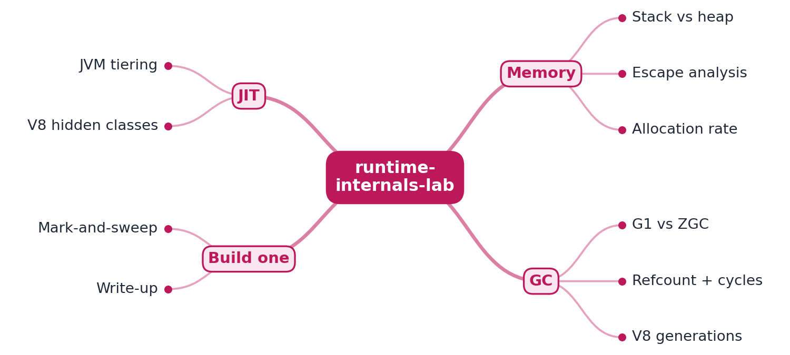

# RFC 0001: runtime-internals-lab design

- **Status:** Accepted (M1 implemented)
- **Author:** EquinoxWN
- **Created:** 2026

## Problem

"Latency spiked and nothing changed" is a common incident report. Often something did change, just
not in the business logic: a field now keeps a reference "for debugging", an `if` now picks between
two `new` expressions, a value object became an immutable accumulator. The code computes the same
result, but the JIT can no longer keep its temporary objects in registers, so they are allocated on
the heap, the garbage collector runs more often, and the tail latency moves. Each runtime manages
this differently: HotSpot's C2 removes allocations with escape analysis, V8's TurboFan does the
same with different limits, and CPython frees most objects by reference counting and runs its
cycle collector on a counter of tracked objects.

Engineers usually reason about this from folklore ("allocation is cheap", "the JIT will remove
it"). This project replaces folklore with measurements: one allocation-heavy workload run in all
three runtimes, and a set of small Java changes whose effect is visible both in the allocation
counters and in C2's own compilation log.

**Users:** backend engineers who debug latency or GC overhead in Java, Python or Node.js services;
engineers preparing for performance and memory questions in interviews; and the author, as the
base for the M2 (G1 vs ZGC with JFR, CPython tracemalloc) and M3 (V8 hidden classes, a toy
mark-and-sweep collector) experiments.

## Critical-to-quality measures (Define)

| CTQ | Measure | Target (M1) |
|---|---|---|
| Same work in every runtime | checksum of every run vs `spec/workload.json` | 100% of runs match, in all three runtimes |
| Repeatable measurement | spread `(max - min) / median` of ns/op over 5 fresh processes per configuration | at most 25% per configuration on a shared laptop; spread is always reported |
| Allocation attribution | escape-analysis variants: bytes per operation with C2 escape analysis on | fixed variants and the control below 0.5 B/op; escaping variants at least one 24-byte `Vec` per operation |
| Log evidence | `<eliminate_allocation>` entries for `Vec` in the `-XX:+LogCompilation` log | at least one for every fixed variant and the control |
| Behaviour preserved | result of each fixed variant vs its escaping variant | identical for every seed tested (200 random seeds in unit tests, plus every experiment run) |
| Containment | files written by JVMs (crash files, heap dumps, compile logs, hsperfdata) and heap size | all inside the repo's git-ignored `.tmp/`; every experiment JVM capped at `-Xmx512m`, Node.js at `--max-old-space-size=512` |
| Build quality | compiler warnings, lint and type errors, known-vulnerable dependencies | 0 |

## Goals

- **M1:** one allocation-heavy workload (`vector-churn`, [spec](../../spec/workload.md)) in Java,
  Python and JavaScript, with a harness per runtime that reports time, allocated bytes and GC
  activity in the same JSON format; a runner that launches each configuration in fresh processes,
  repeats, and reports medians with ranges.
- **M1:** escape-analysis cases in Java where a one-line change decides whether an object reaches
  the heap, measured with escape analysis on and off, and proved from C2's `-XX:+LogCompilation`
  output by a log reader that lists every eliminated allocation with its source line.
- **M2:** G1 vs ZGC pause times with Java Flight Recorder; CPython reference counting, the cycle
  collector and memory growth with `tracemalloc`.
- **M3:** V8 hidden classes and inline caches; a small mark-and-sweep collector in Java; charts.

## Non-goals

- A benchmark suite that ranks languages. The runtimes do different amounts of work per object
  (a CPython `Vec` is a heap object with a type pointer and reference count; a C2 `Vec` may not
  exist at all), so ns/op across runtimes describes this workload on this machine, nothing more.
- Statistical microbenchmarking with JMH, pyperf or mitata (see Alternatives).
- Tuning advice for production collectors; M1 records the default collectors' behaviour.
- Running as a hosted service.

## Proposed design



```
spec/workload.json ──► java/  ChurnMain, EscapeMain   ─┐  one JSON line
   (checksums,      ├─► js/    churn.js, escape-probe.js ├─► per process ──► python -m runtime_internals_lab.compare
    bench params)   └─► python/ churn                  ─┘                     │  validates every line, checks checksums,
                                                                              │  medians [min-max], gates, Markdown
-XX:+LogCompilation ──► python -m runtime_internals_lab.jitlog ◄── javap -l ───┘  (eliminated allocations with source lines)
```

### Workload and harnesses

- `vector-churn` allocates four small immutable `Vec` objects per operation; a `window` keeps the
  last result reachable for `window` operations. Window 0 shows what the runtimes do with pure
  temporaries; window 100,000 adds middle-aged objects that survive a young collection.
- Each harness runs warm-up rounds (so the JIT has compiled the loop), then measured rounds, and
  checks that every round returns the same checksum. Measurements come from each runtime's own
  counters (table in the [spec](../../spec/workload.md#harness-contract)); see ADR 0002.
- The runner starts every configuration in a fresh process (no JIT or heap state carried over),
  interleaves configurations across repetitions so a background load spike hits all of them, and
  validates each JSON line against a strict field list before using it.

### Escape-analysis cases (Java)

| Case | Escaping variant | Fixed variant |
|---|---|---|
| `temporaries` (control) | four temporaries through `add`/`scale` | - |
| `branch-merge` | `v = cond ? new Vec(a, b) : new Vec(b, a)` | choose the two ints, then one `new Vec` |
| `loop-accumulator` | `sum = sum.add(step)` carried around the loop | add the components into two `int` locals |
| `static-store` | `lastSeen = v` (a static field) | store `v.x()` and `v.y()` instead |

Each variant is a small static method, measured in-process with the per-thread allocation counter
after 30 warm-up calls, in JVMs with `-XX:+DoEscapeAnalysis` (default) and `-XX:-DoEscapeAnalysis`.
A third JVM runs with `-XX:+UnlockDiagnosticVMOptions -XX:+LogCompilation`; `jitlog` streams that
XML, scopes `klass`/`method` ids to their `<task>`, and lists each `<eliminate_allocation>` with
its inlining stack, mapped to source lines from `javap -l` (ADR 0003).

### Containment

Every JVM the project starts gets `-Xmx512m -XX:-UsePerfData` and `-XX:ErrorFile`,
`-XX:HeapDumpPath` and `-Djava.io.tmpdir` pointing into `.tmp/` (Maven through `.mvn/jvm.config`,
the test fork through surefire's `argLine`, experiment JVMs through the runner, which a unit test
checks). The compile log is written by a JVM whose working directory and temp folder are `.tmp/jit/`, so its
per-thread `hs_c*.log` files land there too (the runner points `TMP`, `TEMP` and `TMPDIR` at it).

## Alternatives considered

| Option | Why not (yet) |
|---|---|
| JMH (`-prof gc`), pyperf and mitata, one benchmark framework per runtime | JMH is the right tool for nanosecond-level Java claims, but three frameworks report three different statistics and none of them measures GC the same way. M1 needs one harness contract across runtimes and allocation counts, not sub-nanosecond precision; the effects measured here (0 vs 24 B/op, 2.6 vs 6.8 ns/op) are far larger than harness noise. JMH can be added in M3 for the Java numbers. |
| A debug JVM build for `-XX:+PrintEscapeAnalysis` / `-XX:+PrintEliminateAllocations` | These flags exist only in debug builds; CI and readers have release JDKs. `-XX:+LogCompilation` is a diagnostic flag available in every release build and records the same eliminations (ADR 0003). |
| Allocation profilers (async-profiler, JFR `ObjectAllocationSample`, V8 sampling heap profiler) | Sampling profilers show where allocations happen but not their exact count; the per-thread counter gives exact bytes per operation, which makes a fixed variant's 0 B/op a hard check. JFR is used in M2 for pause times. |
| One harness process measuring all configurations in sequence | Cheaper, but JIT state and heap sizing carry over between configurations, which is exactly what the experiment must not mix. Fresh processes cost about 2 minutes per full run. |
| `tracemalloc` to count CPython allocations in M1 | `tracemalloc` hooks every allocation (its overhead is not measured here) and records current and peak traced memory, not total allocated bytes; it is the M2 item for memory growth. M1 reports CPython time and cycle-collector activity and marks allocated bytes as not measured. |

## Measurement plan (Measure, Analyze, Control)

- **Method:** `make bench`: 5 configurations (Java with and without escape analysis, Node.js with
  and without `--no-turbo-escape`, CPython) x windows 0 and 100,000 x 5 fresh processes, interleaved;
  1,000,000 operations per round; Java and Node.js 20 warm-up + 20 measured rounds, CPython 1 + 3.
  `make escape`: 7 variants x escape analysis on/off x 5 JVMs (30 warm-up + 10 measured calls of
  1,000,000 operations), one LogCompilation run, and the V8 probe with and without TurboFan's
  escape analysis, 5 processes each.
- **Reported:** median and min-max of ns/op; allocated bytes per operation; GC count and GC time
  per million operations; runtime versions and flags; spread.
- **Control:** unit tests in all three runtimes check the shared checksums; `EscapeAnalysisTest`
  checks the 0 vs 24 B/op claim inside the test JVM; `make bench` exits 3 on any checksum
  mismatch; `make escape` exits 3 when a fixed variant allocates, an escaping one stops
  allocating, or the log shows no eliminated `Vec` for a fixed variant. CI runs both and prints the
  `RESULT` lines as annotations.

## Milestones

- **M1:** the shared workload in three runtimes; Java escape-analysis cases with log evidence. Done.
- **M2:** G1 vs ZGC pause times with Java Flight Recorder; CPython reference counting, cycle
  collector and `tracemalloc` experiments.
- **M3:** V8 hidden classes and inline caches; a tiny mark-and-sweep collector in Java; pause-time
  and allocation charts.

## Risks and open questions

- **JIT decisions are version-specific.** Every claim is for Temurin 21.0.12.1 and Node.js 24.19.0
  (V8 13.6). CI uses the latest Temurin 21 and Node.js 24 patch releases, so the gates may fail
  after an upgrade if a JIT starts (or stops) removing an allocation; that failure is the signal,
  not noise.
- **Wall times on a shared laptop are noisy.** Other builds run in parallel on the same machine.
  The design answers with fresh processes, interleaving and reported ranges, and gates only on
  allocation counts and log evidence, which do not depend on load.
- **GC timings differ in resolution.** HotSpot's MXBean reports milliseconds, V8's GCProfiler
  microseconds, CPython's callbacks nanoseconds; per-pause analysis of the JVM is left to JFR (M2).
- **V8's allocated bytes are derived** from the used heap size before and after each GC, not counted
  per allocation. A kernel with no objects measures 0.0 B/op, so the method adds no bytes of its
  own, but the per-object sizes it implies are not checked against V8's object layout yet (M3).
